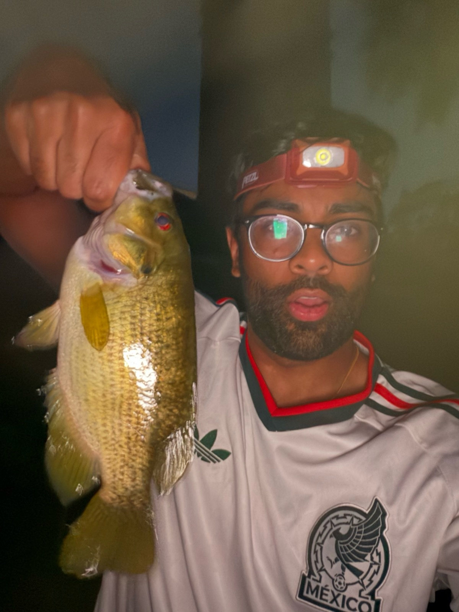
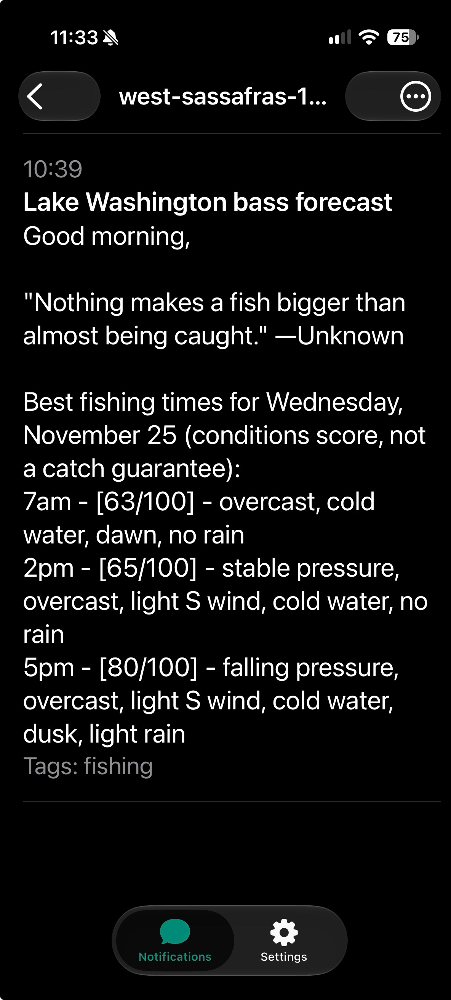
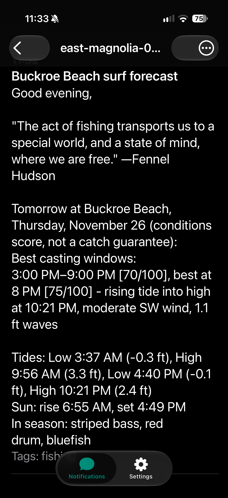
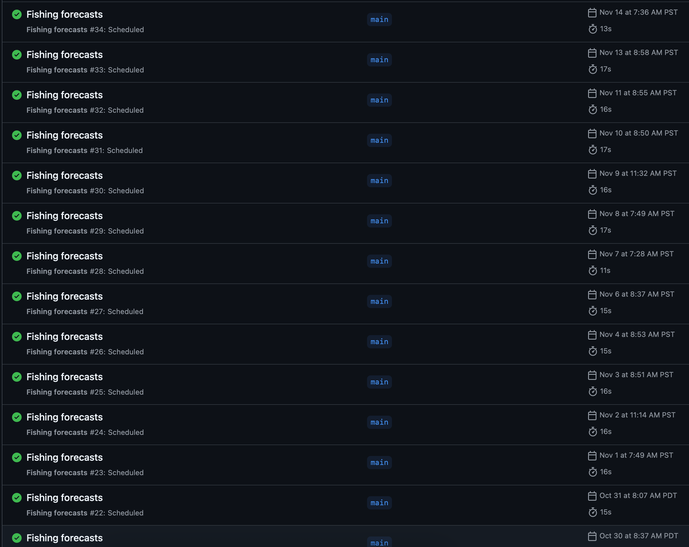

# Bassline

 
<em>A rock bass, caught at night on Lake Washington</em>

## Background

I am a self-taught angler who enjoys the great outdoors as well as creating things. I wanted a cheap and lightweight solution to have more productive fishing sessions.

## What it is

Bassline is a small automated fishing forecast. Every day it checks the conditions at the spots I fish, gives each time window a 0–100 conditions score, and sends the results to my phone as a push notification. The score rates the conditions and obviously doesn't guarantee a catch ;)

The project started out just for largemouth bass (hence the name), but expanded to different types of fishing as I got more into the hobby.

## What a forecast looks like

**Freshwater: Lake Washington bass.** The forecast picks out the best hours of the day and lists the reason behind each score:

**Saltwater: Buckroe Beach surf.** The surf forecast also covers tides, wave height, sunrise and sunset, and the species that are in season:

## How it works

- **Schedule:** a GitHub Actions workflow named *Fishing forecasts* runs every day. Each run takes about 15 seconds.
- **Data:** weather, pressure, wind and waves come from Open-Meteo, tides come from NOAA (Old Point Comfort station), and water temperature is estimated from the past week's air temperatures.
- **Scoring:** each hour starts at 50, gains or loses points for pressure, wind, clouds, light, water temperature, tide and season, loses the most for storms and heavy rain, and is capped between 0 and 100.
- **Delivery:** each forecast goes out as a push notification to my phone.

## What's next

- More locations on Lake Washington (it's a big lake)
- Bait recommendations (based on season) for Buckroe Beach
- Elliott Bay squidding workflow 🦑 
- Creating a UI
    - Upload pictures
    - Caught fish inventory
